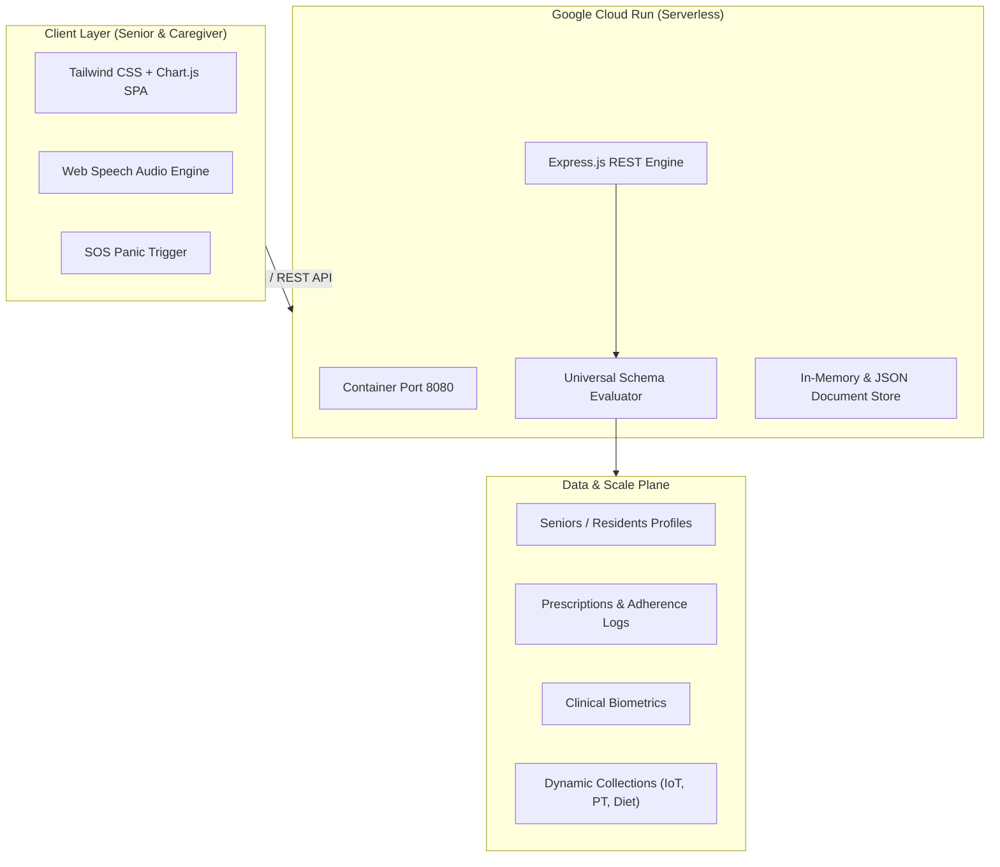

# 🛡️ AegisCare - Elderly Care & Smart Medication Management Platform
> **Hackathon Edition**: Built for High Reliability, Dynamic Schemas, Any Number of Records, and Serverless Google Cloud Run Deployment.

[](https://cloud.google.com/run)
[](https://docker.com)
[](https://nodejs.org)
[](https://tailwindcss.com)
[](https://opensource.org/licenses/MIT)

---

## 🌟 Executive Summary & Hackathon Pitch

Elderly care and assisted living environments face critical hurdles:
1. **Medication Non-Adherence & Stockouts**: Elderly patients often take 5–10 distinct medications with strict timings. A missed dose or unplanned stockout can lead to preventable hospitalizations.
2. **Rigid Healthcare Data Silos**: Traditional Electronic Health Records (EHR) cannot easily adapt to custom needs (e.g. tracking specific physical therapy milestones, dysphagia choking logs, smart bed IoT telemetric feeds, or hydration percentages).
3. **Emergency Latency**: Immediate distress signaling and nurse dispatch need zero-latency interfaces with acoustic alerts and assistive text-to-speech for visually impaired seniors.

**AegisCare** solves this by unifying:
- **Intelligent Medication Hub**: Real-time dose logging, refill thresholds, adherence streaks, and audio voice prompts.
- **Universal Dynamic Data Engine**: Define **ANY custom schema** (text, numbers, dates, booleans, select menus, JSON telemetry) and scale to **ANY number of records**.
- **Clinical Vitals & Biometrics Analytics**: Interactive Chart.js trend tracking for BP, Blood Glucose, SpO2, Heart Rate, and Pain scale.
- **Instant SOS Panic & Beacon**: Audible siren with visual dispatch banner.
- **Serverless Cloud Run Native**: Containerized with sub-second cold starts, zero cost at rest, auto-scaling from 0 to 1,000+ instances.

---

## 🏗️ System Architecture



---

## ⚡ Features Matrix

| Feature | Description |
| :--- | :--- |
| **Universal Data Engine** | Dynamically create and query arbitrary collections (e.g., IoT Sensors, Speech Therapy, Fluid Balances) with custom data types. |
| **High-Volume Scale Demo** | 1-click synthetic generator that seeds 10, 50, 200, or 1,000+ records to demonstrate high-capacity indexing. |
| **Smart Medication Hub** | Track doses (taken, snoozed, missed), remaining pill counts, and automated low-stock warnings. |
| **Voice Reminders** | Built-in browser speech synthesis that vocalizes prescription instructions for seniors. |
| **Emergency SOS Siren** | Acoustic Web Audio synthesizer that blares alarms and dispatches care personnel to the resident's room. |
| **Accessibility Mode** | High-contrast, large-font toggle designed specifically for elderly accessibility. |
| **Data Mobility** | Complete JSON snapshot export and import for seamless cloud backups. |

---

## 🚀 Quickstart: Running Locally

You can launch and explore the platform immediately:

### Option A: Standalone Instant Launch (No build required)
Double-click or open `public/index.html` directly in any web browser (Google Chrome, Microsoft Edge, Safari, Firefox). The frontend features built-in fallback mock data and offline state handling.

### Option B: Local Node.js Server
```bash
npm install
npm start
```
Visit: **http://localhost:8080**

---

## 🌐 Deploying to Google Cloud Run (Getting your Live URL)

Google Cloud Run offers fully managed serverless container execution with auto-scaling to zero and free-tier allocation.

### 1-Click Automated Script
- **On Windows**:
  ```cmd
  deploy-cloudrun.bat
  ```
- **On Linux / macOS / Cloud Shell**:
  ```bash
  chmod +x deploy-cloudrun.sh
  ./deploy-cloudrun.sh
  ```

### Manual Command Line Deployment
Ensure `gcloud` CLI is logged in:
```bash
# 1. Login to Google Cloud
gcloud auth login

# 2. Set your GCP project
gcloud config set project YOUR_PROJECT_ID

# 3. Enable Cloud Run and Cloud Build APIs
gcloud services enable run.googleapis.com cloudbuild.googleapis.com

# 4. Deploy directly from source
gcloud run deploy aegiscare-platform \
    --source . \
    --platform managed \
    --region us-central1 \
    --allow-unauthenticated \
    --port 8080 \
    --memory 512Mi \
    --cpu 1
```

Once deployment completes, Cloud Run will print your live production URL:
```text
Service [aegiscare-platform] revision [aegiscare-platform-00001-abc] has been deployed and is serving 100 percent of traffic.
Service URL: https://aegiscare-platform-xxxxxx-uc.a.run.app
```

---

## 🐙 Creating & Pushing to GitHub

### Automated Script
- **On Windows**: Run `setup-github.bat`
- **On Linux/macOS**: Run `setup-github.sh`

### Manual Git & GitHub Setup
```bash
# Initialize git repository
git init
git checkout -b main
git add .
git commit -m "feat: initial commit of AegisCare elderly care & medication management platform"

# Push to your GitHub account (replace with your repo URL)
git remote add origin https://github.com/YOUR_USERNAME/aegiscare-platform.git
git branch -M main
git push -u origin main
```

### Automated GitHub Actions CI/CD
This repository includes `.github/workflows/deploy.yml`. When you push to the `main` branch, it automatically builds the Docker container and deploys it to Google Cloud Run using GitHub Actions secrets:
- `GCP_PROJECT_ID`: Your Google Cloud Project ID
- `GCP_SA_KEY`: Google Cloud Service Account JSON Key (with `Cloud Run Admin` and `Storage Admin` roles)

---

## 📡 RESTful API Documentation

| Endpoint | Method | Description |
| :--- | :--- | :--- |
| `/api/health` | `GET` | Health check for Cloud Run container probes |
| `/api/summary` | `GET` | High-level KPI counters (seniors, meds, alerts) |
| `/api/seniors` | `GET`, `POST` | Query & register residents |
| `/api/seniors/:id` | `PUT`, `DELETE` | Update or remove resident profile |
| `/api/medications` | `GET`, `POST` | List prescriptions and filter by resident |
| `/api/medications/:id/log` | `POST` | Log dose administration (`taken`, `missed`) |
| `/api/vitals` | `GET`, `POST` | Query and record clinical biometrics |
| `/api/sos` | `POST` | Trigger emergency panic alert |
| `/api/dynamic-collections` | `GET`, `POST` | Define and query custom dynamic schemas |
| `/api/dynamic-data/:colId` | `GET`, `POST` | Query & insert records into custom schema |
| `/api/seed` | `POST` | Bulk-generate $N$ records for scale tests |
| `/api/export` | `GET` | Download full platform JSON backup |
| `/api/import` | `POST` | Import external dataset or backup |

---

## 🏆 Hackathon Presentation Checklist

- [x] **Universal Schema Demonstration**: Navigate to the **Dynamic Data Engine** tab to show custom schema creation (e.g. Physical Therapy logs, Bed Sensors).
- [x] **Scale Stress Test**: Navigate to **Scale & Cloud Info** tab and click **"+1,000 High-Capacity Stress Test"** to prove the system handles any number of records effortlessly.
- [x] **Audio & Speech Reminders**: Click **"Voice Reminders"** to showcase accessibility for elderly patients.
- [x] **Emergency SOS Demonstration**: Click the red **"SOS PANIC"** button to showcase audible warning tone and real-time nurse dispatch banner.
- [x] **Cloud Native**: Present the `Dockerfile`, `cloudbuild.yaml`, and live Cloud Run architecture.

---
Developed with ❤️ for the Hackathon.
